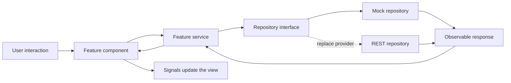

# Angular Learning Guide for This Project

This documentation is a guided course through the Angular application in this repository. It assumes you already understand JavaScript, React, and Next.js, but have not worked with Angular.

The goal is not only to understand each Angular keyword. By the end, you should be able to:

- Read the project without needing to search every unfamiliar syntax feature.
- Explain how data moves from a user interaction through a component, service, and repository.
- Add a feature using the same architecture.
- Replace the mock repositories with a real REST API.
- Write Angular tests and reason about loading, errors, and cleanup.
- Know which parts of React knowledge transfer and which need a different mental model.

## Recommended reading order

1. [Learning roadmap](./01-learning-roadmap.md) — a six-week plan with concrete checkpoints.
2. [Angular mental model](./02-angular-core-concepts.md) — translate React/Next.js ideas into Angular ideas.
3. [Project code tour](./03-project-code-tour.md) — follow the actual code path used by this application.
4. [RxJS and state guide](./04-rxjs-and-state.md) — understand observables, operators, and signals.
5. [Forms, routing, testing, and tooling](./05-forms-routing-testing-tooling.md) — the remaining Angular systems used here.
6. [Exercises and progress tracker](./06-exercises-and-progress.md) — practice by making small, testable changes.
7. [Quick reference and glossary](./07-quick-reference-glossary.md) — find an API, dependency, or term quickly.

## The short version

Angular is not React with different function names. The biggest differences are:

| React/Next.js                               | This Angular project                                  |
| ------------------------------------------- | ----------------------------------------------------- |
| Function component and JSX                  | Component class and HTML template                     |
| Props                                       | Signal inputs                                         |
| Callback props                              | Signal outputs                                        |
| `useState`                                  | `signal`                                              |
| Derived values computed during render       | `computed`                                            |
| Context or external store                   | Services and dependency injection                     |
| Hooks order and effect dependencies         | Signal dependency tracking and Angular lifecycle      |
| React Router or Next.js App Router          | Angular Router configuration                          |
| Rendering can be server-driven with Next.js | This project is a client-side single-page application |
| Often fetch directly in components          | Services and repositories isolate data access         |

Angular templates look declarative like JSX, but they are compiled into efficient update instructions by Angular. Component classes own behavior. Templates own structure and event bindings. Styles are scoped to the component by default.

## Project architecture in one diagram

The UI never imports the mock repository directly. Components use business services. Services depend on repository interfaces identified by `InjectionToken`s. `app.config.ts` decides which concrete repository is active. That is the key reason the mock API can later be replaced by REST without changing the UI components.

## How much time this will take

The roadmap is designed for roughly one focused hour on five weekdays, plus a two-hour consolidation session. At that pace it takes about six weeks. If you work full time on it, the same sequence can be compressed to one or two weeks.

You do not need to learn Angular completely before working with this project. Read the mental model, complete the first two roadmap phases, then start modifying small parts of the code while continuing through the remaining chapters.

## Repository map

| Area                  | Purpose                                                  | Start here                                                                   |
| --------------------- | -------------------------------------------------------- | ---------------------------------------------------------------------------- |
| Application bootstrap | Starts Angular and registers global providers            | [`src/main.ts`](../src/main.ts), [`app.config.ts`](../src/app/app.config.ts) |
| Shell                 | Sidebar, top bar, router outlet, mobile navigation       | [`app.ts`](../src/app/app.ts), [`app.html`](../src/app/app.html)             |
| Domain models         | Typed users, roles, requests, and results                | [`models/`](../src/app/core/models/)                                         |
| Repository layer      | API contracts, injection tokens, persistent mock storage | [`repositories/`](../src/app/core/repositories/)                             |
| Business services     | Feature operations, exports, roles, notifications        | [`services/`](../src/app/core/services/)                                     |
| Member feature        | Dashboard, table, filters, bulk actions, dialogs         | [`features/users/`](../src/app/features/users/)                              |
| Role feature          | Role list, permission matrix, unsaved-change protection  | [`features/roles/`](../src/app/features/roles/)                              |
| Shared UI             | Avatar, status badge, icon, confirmation, toast          | [`shared/`](../src/app/shared/)                                              |
| Global styling        | Variables, controls, dialogs, accessibility primitives   | [`styles.scss`](../src/styles.scss)                                          |

## Two practices to adopt immediately

First, when you see a signal, read `value()` as “get the current value and subscribe the current view or computed expression to future changes.” This is the closest mental model to state read in React, although Angular does not re-run the whole function component.

Second, do not confuse an RxJS subscription with a React effect. An `Observable` describes a stream of future values. A `Subscription` starts consuming that stream. Angular’s `takeUntilDestroyed` connects the subscription lifetime to the component lifetime so it is automatically cleaned up.

With those two ideas in place, the rest of the project becomes much easier to navigate.
